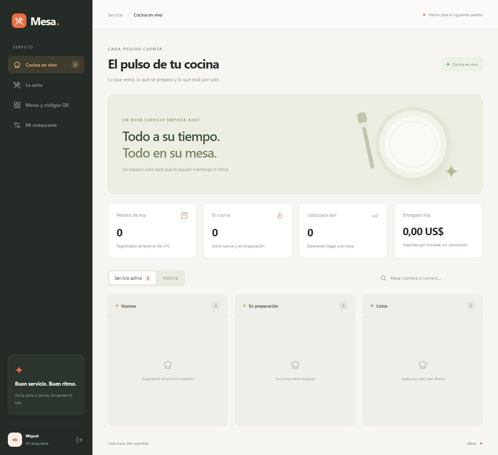

# Mesa

La carta, los pedidos y la cocina al mismo ritmo.

Mesa es una aplicación para restaurantes pequeños que quieren recibir pedidos desde la mesa sin depender de una plataforma externa. El cliente escanea un QR, elige sus productos y consulta el estado del pedido. El restaurante lo gestiona desde un tablero de cocina en vivo.

**Self-hosted restaurant ordering, QR menus and a live kitchen board.**




## Qué incluye

- Carta con categorías, descripciones, precios y disponibilidad.
- Mesas con enlaces propios y códigos QR descargables.
- Carrito y envío del pedido desde el navegador del cliente.
- Tablero con pedidos nuevos, en preparación y listos para servir.
- Historial de entregados y cancelados, búsqueda y exportación JSON.
- Seguimiento privado del pedido para el cliente.
- Cuentas separadas para cada restaurante.
- Interfaz adaptable y animaciones que respetan la preferencia de movimiento reducido.

La instalación empieza vacía. No hay cuentas, productos ni pedidos de demostración.

## Instalar

Necesitas **Node.js 22.13 o superior** y npm. SQLite viene incluido en Node; no requiere un servicio adicional. En Node 22 puede aparecer un aviso experimental de SQLite.

```sh
git clone https://github.com/MIGUEL-MOSCOSO-DEV/mesa.git
cd mesa
npm ci
npm run dev
```

Abre **http://localhost:3100** y crea tu cuenta. Configura el nombre y la moneda en **Mi restaurante**, añade productos en **La carta** y crea tus mesas. Guarda los enlaces o descarga sus QR antes de cerrar el diálogo.

## Producción

```sh
npm run build
npm start
```

El servidor entrega la interfaz compilada y la API desde la misma dirección. Para recibir pedidos desde otros dispositivos, configura un dominio con HTTPS y ajusta **APP_URL**. Un QR que apunta a localhost solo abre la aplicación en el equipo donde está instalada.

Puedes copiar **.env.example** a **.env** y cambiar:

- **PORT**: puerto HTTP; por defecto, 3100.
- **HOST**: interfaz de escucha; por defecto, 127.0.0.1. Usa 0.0.0.0 cuando lo requiera tu alojamiento o red.
- **APP_URL**: dirección pública de Mesa. Debe coincidir con la dirección usada en el navegador.
- **DATABASE_PATH**: archivo SQLite; por defecto, ./data/mesa.sqlite.

Las rutas relativas se resuelven desde la carpeta del proyecto. Si cambias la dirección pública, genera de nuevo los QR. Con HTTPS, las cookies usan Secure. La aplicación no confía automáticamente en cabeceras de proxy; configura esa confianza según tu infraestructura si necesitas límites por IP detrás de un proxy.

## Cómo se mueve un pedido

El cliente solo puede pedir productos disponibles. El servidor consulta la carta y calcula el importe: los precios enviados por el navegador no deciden el total. Cada pedido conserva una copia de nombres, precios y moneda.

El recorrido es **nuevo → en preparación → listo → entregado**. Los pedidos activos se pueden cancelar; los cerrados conservan su historial y no retroceden. Una clave única de solicitud evita registrar dos veces el mismo envío. Si una conexión falla después del envío, consulta con el personal antes de iniciar otro pedido.

El tablero recibe actualizaciones mediante Server-Sent Events. La pantalla del cliente consulta el estado cada cinco segundos. Si usas un proxy inverso, desactiva el buffering para la ruta de eventos.

Los enlaces de mesa y de seguimiento son distintos. Renovar un QR invalida la carta anterior de esa mesa; pausar la mesa bloquea pedidos nuevos. Los pedidos existentes siguen disponibles desde sus enlaces de seguimiento.

Las métricas del día usan UTC. Los importes se muestran separados por moneda y no se convierten. Mesa registra pedidos, pero no procesa pagos, emite comprobantes fiscales ni sustituye las conversaciones con el personal sobre alergias o disponibilidad.

## Datos

Los registros se guardan en SQLite. Para una copia completa, detén la aplicación y copia el archivo indicado por **DATABASE_PATH**. Guarda la copia fuera del servidor antes de volver a iniciarlo. No copies únicamente el archivo principal mientras haya escrituras: SQLite puede tener datos pendientes en su WAL.

La exportación JSON contiene los pedidos de la cuenta, sin contraseñas ni tokens. Sirve para consultar datos; no es un reemplazo de la copia de SQLite ni incluye un importador.

## Desarrollo

```sh
npm test
npm run check
npm run format:check
npm run build
```

- **src/** contiene la interfaz React, la carta pública y el tablero.
- **server/** contiene Express, las sesiones, la validación y SQLite.
- **shared/** contiene el cálculo de importes y las transiciones de pedidos.
- **tests/** verifica permisos, precios, disponibilidad, estados, QR y eventos en vivo.

Las pruebas usan bases en memoria y directorios temporales aislados. No escriben en los datos de la aplicación. Las contraseñas se derivan con scrypt; las sesiones y los enlaces guardan huellas de sus tokens. Las consultas usan parámetros y la API valida sus entradas con Zod.

El registro de cuentas está abierto. Esta versión no incluye recuperación de contraseña, verificación de correo ni roles para empleados de un mismo restaurante. Para una instalación privada, limita el acceso desde tu red o proxy.

## Contribuir

Abre un issue con los pasos para reproducir el problema. Si propones un cambio en precios, permisos o estados, acompáñalo de una prueba que cubra ese comportamiento.

## Licencia

[MIT](LICENSE). Creado por [Miguel Moscoso](https://github.com/MIGUEL-MOSCOSO-DEV).
